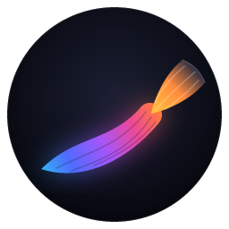

<div align="center">



# rustcreate

**A fast, native painting and animation app inspired by Procreate, with the Photoshop features
people miss in it. 100% Rust: egui for the interface, wgpu for the canvas.**

[](https://github.com/Juanestban/rustcreate/actions/workflows/ci.yml)
[](#license)


</div>

rustcreate is a raster painting app: a pressure-sensitive brush engine, Photoshop-style layers
with blend modes, a minimal Procreate-like interface in dark and light themes, Photoshop keyboard
shortcuts and, later, frame-by-frame animation.

> [!NOTE]
> rustcreate is in early development and runs on **Windows** first. macOS, iPhone/iPad, Android
> and Linux come later. What works today is in [docs/ROADMAP.md](docs/ROADMAP.md).

rustcreate is an independent project. It is not affiliated with or endorsed by Savage
Interactive (Procreate) or Adobe (Photoshop), and it ships no assets from either
([ADR 0006](docs/adr/0006-original-assets-only.md)).

## Installation

Every [release](https://github.com/Juanestban/rustcreate/releases) ships two Windows downloads:

- **`Rustcreate-<version>-x64.msi`**: installs for your user only in
  `%LOCALAPPDATA%\Programs\rustcreate`, no administrator rights needed. Uninstall it from
  *Settings → Apps*.
- **`Rustcreate-<version>-x64-portable.exe`**: a single file. Put it anywhere and run it.

Both check for new versions when they start and every 5 hours, show a banner when one is
available, and update themselves when you click **Update**
([ADR 0002](docs/adr/0002-updates-from-github-releases.md)).

They are not code-signed (like many open-source projects), so Windows SmartScreen may show
*"Windows protected your PC"* or *"Unknown publisher"*. To run them anyway: **More info → Run
anyway**. To check that a file is the published one, compare its SHA-256
(`Get-FileHash <file>`) with `SHA256SUMS.txt` from the same release.

### Requirements

- Windows 10 1809 or newer, x64.
- A GPU with DirectX 12 or Vulkan.
- Optional: a pen tablet in Windows Ink mode (Wacom, Surface, XP-Pen, Huion…) for pressure and
  tilt ([ADR 0004](docs/adr/0004-pen-input-windows-ink.md)).

## Keyboard shortcuts

rustcreate uses the Photoshop shortcuts you already know: `B` brush, `E` eraser, `[` / `]` brush
size, `Ctrl+Z` undo, `Ctrl+J` duplicate layer, `Space` pan… The full list is in
[docs/SHORTCUTS.md](docs/SHORTCUTS.md).

## Building from source

### Requirements (all platforms)

- [Rust](https://rustup.rs/) stable (edition 2024 needs 1.85 or newer)
- Git
- A GPU driver with DirectX 12, Vulkan or Metal (used by wgpu)

### Windows (main platform)

1. Install the **Visual Studio Build Tools** with the *Desktop development with C++* workload.
   Rust needs them to link, and their Windows SDK includes `rc.exe`, which embeds the icon in
   the `.exe`.
2. Install Rust from <https://rustup.rs/> (the default `x86_64-pc-windows-msvc` toolchain).
3. Clone and build:

   ```powershell
   git clone https://github.com/Juanestban/rustcreate.git
   cd rustcreate
   cargo build --release -p rustcreate
   ```

4. The portable executable is `target\release\rustcreate.exe`.

`.cargo/config.toml` forces C dependencies to build with MSVC even if the environment sets
`CC=gcc`.

### macOS and Linux (not officially supported yet)

The code is meant to compile on other platforms, but it is untested and pen input only exists
on Windows for now.

```sh
git clone https://github.com/Juanestban/rustcreate.git
cd rustcreate
cargo run --release -p rustcreate
```

On Debian/Ubuntu, egui needs: `sudo apt install build-essential pkg-config libxkbcommon-dev
libxcb-render0-dev libxcb-shape0-dev libxcb-xfixes0-dev libssl-dev`.

## Structure

```
crates/core     document model: canvas tiles, layers, blend modes, history, .rcreate files (no GPU)
crates/render   wgpu: layer compositor, blend-mode shaders, canvas view
crates/app      the app: egui interface, themes, icons, shortcuts, texts (locales/), updater
docs/           design, roadmap, shortcuts and architecture decisions (docs/adr/)
wix/            MSI installer definition
scripts/        release packaging
```

## Releasing

See [RELEASING.md](RELEASING.md).

## License

Licensed under either of

- Apache License, Version 2.0 ([LICENSE-APACHE](LICENSE-APACHE))
- MIT license ([LICENSE-MIT](LICENSE-MIT))

at your option.

Unless you explicitly state otherwise, any contribution intentionally submitted for inclusion in
the work by you, as defined in the Apache-2.0 license, shall be dual licensed as above, without
any additional terms or conditions.
